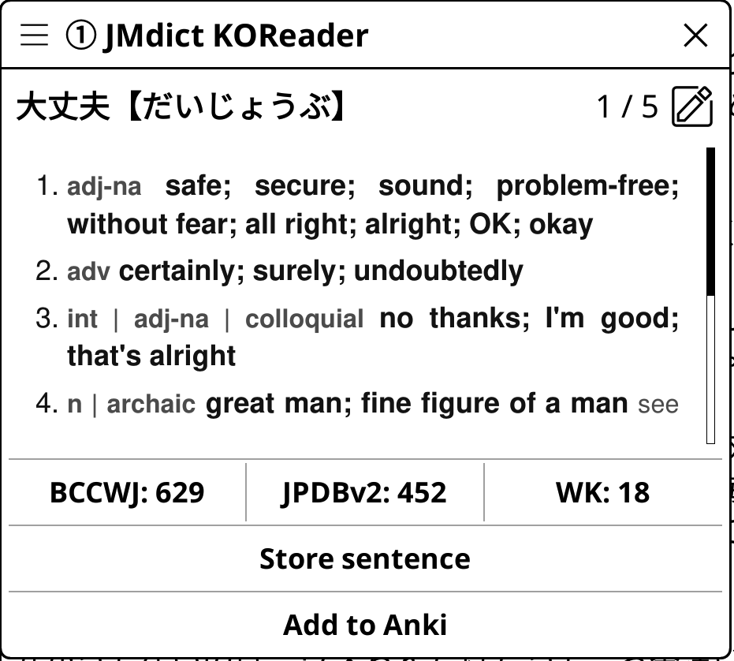

# KOReader Dictionary Meta Information
## Yomitan-like frequency information on KOReader

This plugin extends the KOReader dictionary window with meta information for a given word entry, provided from a database separate from the dictionary files themselves.

Using KOReader's api to add buttons to the dictionary window, the position the buttons containing this meta information can be configured in KOReader.

This plugin will offer its functionality only when a *profile* is configured that lists the document
language in `Profile.languages`.



### Setup

This plugin uses *profiles* to translate dictionary entries into database lookup keys and configure which metadata to fetch.
The included default profile is [Japanese Yomitan frequency](profiles/ja_yomitan.lua).

1. Download and extract this repository. Rename the folder `dictionarymeta.koplugin` and place it in KOReader's `plugins` directory, with `yomitan_freq.db` in the plugin directory alongside `main.lua`.
    - You can download `yomitan_freq.db` here: https://github.com/UnexpectedTiramisu/immersionkit-dictionary-meta-db-builder/releases/tag/v1.0.0
2. Open a book whose document language is `ja`, `jp`, or `jpn`. Regional forms such as `ja-JP` and `ja_JP` also match.
    - If you would like to use this plugin with other languages or frequency sources, please see the explanation in the readme below.
3. Look up a word. The Japanese profile activates automatically when it is the only matching profile and no choice has been saved for that language.

Use **Dictionary metadata** in KOReader's menu to select a profile or choose **Disable metadata for this language**. Choices are saved per normalized document language, not per book or dictionary. If several profiles match, select one from this menu. Without a document language or a matching profile, metadata stays inactive.

Configure the metadata button layout in the dictionary settings (Magnifying glass icon > Dictionary Settings > Customize buttons), where you can define which of the three meta buttons should active,
and where they should appear.

### Default profile

The following is the complete `profiles/ja_yomitan.lua` profile:

```lua
local Profile = {
    -- Unique ID saved in the user's profile selection.
    id = "ja_yomitan",
    -- Name shown in the profile menu.
    label = "Japanese Yomitan frequency",
    -- Document languages supported (case and regional suffixes are ignored).
    languages = { "ja", "jp", "jpn" },
}

Profile.database = {
    -- Local meta information SQLite file, relative to the plugin directory. Please see https://github.com/UnexpectedTiramisu/immersionkit-dictionary-meta-db-builder/ for more information.
    filename = "yomitan_freq.db",
    -- Map returned lookup keys to term_meta columns; all must match exactly.
    lookup_columns = {
        { key = "headword", column = "headword" },
        { key = "reading", column = "reading" },
    },
    -- Numeric rank used for sorting (lower first) and metadata button text.
    rank_column = "value_num",
    -- Extra columns to fetch, these do not currently change button text.
    display_columns = { "value_text" },
}

Profile.dictionary = {}

-- Receives a KOReader dictionary result table, including word (the heading)
-- and dict (the dictionary name). This profile only needs dict_word.word.
-- Example input: { word = "食べる【たべる】", dict = "My dictionary", ... }
-- Return a table containing every key configured in lookup_columns:
-- { headword = "食べる", reading = "たべる" }. Return nil to skip a result.
function Profile.dictionary.to_lookup_key(dict_word)
    -- This profile expects Japanese headings in headword【reading】 form.
    local outside, inside = dict_word.word:match("^(.-)【(.-)】")

    if not outside or not inside then
        -- Without brackets, use the heading for both headword and reading.
        local word = Profile.dictionary.get_first_part(dict_word.word)
        return {
            headword = word,
            reading = word,
        }
    end

    return {
        headword = Profile.dictionary.get_first_part(outside),
        reading = Profile.dictionary.get_first_part(inside),
    }
end

-- Helper for this dictionary heading format, not a required profile function.
-- Keeps the first alternative separated by the Japanese middle dot (・),
-- e.g. "食べる・喰べる" becomes "食べる". Adapt/remove for other formats.
function Profile.dictionary.get_first_part(value)
    local separator = value:find("・", 1, true)
    return separator and value:sub(1, separator - 1) or value
end

return Profile
```

### Adding a profile

Copy `profiles/ja_yomitan.lua`, give the copy a unique `id`, and adapt its language codes, lookup function, and database configuration to your dictionary's heading format and database columns. Every configured lookup key must be returned by `to_lookup_key`.

Register the module in `PROFILE_MODULES` near the top of `main.lua`, without the `.lua` extension. For example, for `profiles/my_profile.lua`:

```lua
local PROFILE_MODULES = {
    "profiles/ja_yomitan",
    "profiles/my_profile",
}
```

Profiles are not discovered automatically. Restart KOReader after adding or editing a profile, then select it under **Dictionary metadata** while a book with a supported language is open.

### Lookup example

The Japanese profile expects dictionary headings in `headword【reading】` form. It keeps only the first alternative separated by `・` on each side. Without brackets, it uses the same text for both keys.

| Dictionary result (`dict_word.word`) | `headword` | `reading` |
| --- | --- | --- |
| `食べる【たべる】` | `食べる` | `たべる` |
| `食べる・喰べる【たべる】` | `食べる` | `たべる` |
| `こんにちは` | `こんにちは` | `こんにちは` |

For `食べる【たべる】`, the plugin looks for rows where `term_meta.headword = '食べる'` **and** `term_meta.reading = 'たべる'`. For example, given a source with `id = 1` and `title = 'Example frequency'`, this metadata row:

| `source_id` | `headword` | `reading` | `value_num` | `value_text` |
| --- | --- | --- | --- | --- |
| 1 | 食べる | たべる | 123 | 123 |

produces a button caption of `Example frequency: 123`. A source without a matching row displays `Example frequency: -`.

For duplicate matches within a source, the plugin uses the lowest rank value. Preferred dictionaries retain precedence. Within the same dictionary preference, ranked results come before unranked results and lower ranks come first.

### Database structure

To get an overview of how the database is created for use with Japanese and to download the database that provides Japanese frequency information,
please see the [Dictionary MetaDB Builder](https://github.com/UnexpectedTiramisu/immersionkit-dictionary-meta-db-builder) repository.

Use a SQLite file with these two tables. These sample columns match the default profile.

**`meta_source`** — one row per frequency source:

| `id` (unique integer) | `title` (text) | `sort_priority` (integer) |
| --- | --- | --- |
| 1 | Example frequency | 10 |
| 2 | Another frequency | 0 |

**`term_meta`** — word metadata linked to a source:

| `source_id` (integer) | `headword` (text) | `reading` (text) | `value_num` (number) | `value_text` (text) |
| --- | --- | --- | --- | --- |
| 1 | 食べる | たべる | 123 | 123 |
| 2 | 食べる | たべる | 456 | 456 |
| 1 | こんにちは | こんにちは | 789 | 789 |

`source_id` links to `meta_source.id`. Higher `sort_priority` chooses which source supplies the sorting rank. Table names and source columns are fixed; word and value columns must match the profile's `lookup_columns`, `rank_column`, and `display_columns`.
